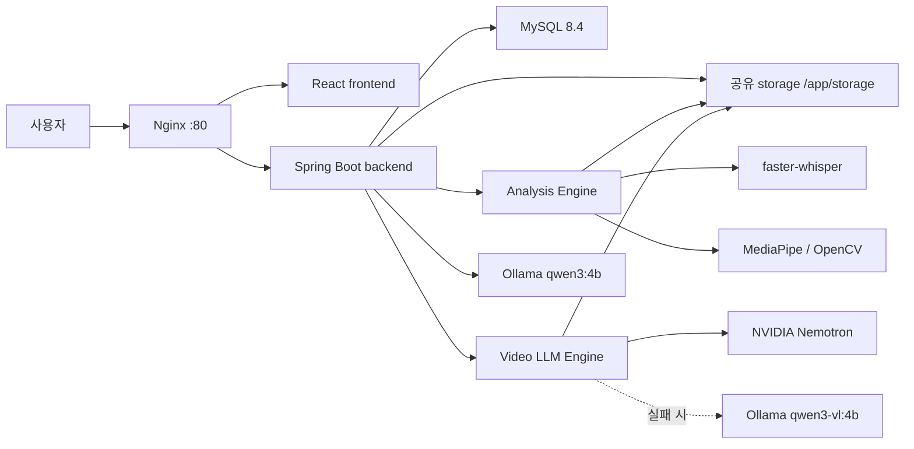

# 피치메이트

피치메이트는 발표 영상을 업로드하면 음성, 자세, 표정, 시선 처리, 제스처를 분석하고 한국어 코칭 리포트를 제공하는 서비스입니다. 팀명은 **MULMOCO**, 서비스명은 **피치메이트**입니다.

## 핵심 기능

- 회원가입, 로그인, access token 및 refresh cookie 기반 인증
- 최대 500MB 영상 업로드와 업로드 요청 취소
- 업로드 후 비동기 분석 자동 시작 및 상태 polling
- `QUEUED`, `PROCESSING`, `CANCEL_REQUESTED`, `CANCELED`, `DONE`, `FAILED` 상태 처리
- 분석 취소, 실패·취소 작업 재분석, 완료·실패·취소 리포트 삭제
- 자세 25%, 표정 20%, 시선 처리 20%, 음성 25%, 제스처 10%의 정량 점수
- NVIDIA Nemotron 시각 관찰과 Ollama fallback
- Ollama `qwen3:4b` 한국어 최종 피드백과 결정적 fallback
- 사용자별 리포트 보관함, 관리자 운영 화면, 재시작 작업 복구
- Flyway 마이그레이션, DB·storage 백업/복원 스크립트, GitHub Actions CI

논리 구조는 정성 피드백에만 사용하며 종합 점수에는 포함하지 않습니다. Video LLM 관찰도 정량 점수를 직접 변경하지 않습니다.

## 시스템 구성



| 구성 요소 | 주요 기술 | 역할 |
|---|---|---|
| `frontend` | React 18, Vite 6, Axios, React Router | 사용자·관리자 화면 |
| `backend` | Java 21, Spring Boot 3.3.5, Spring Security, JPA, Flyway | 인증, 작업 상태, 엔진 연동, 결과 저장 |
| `analysis-engine` | Python 3.12, FastAPI, OpenCV, MediaPipe, faster-whisper | 음성·시각 정량 분석과 점수 계산 |
| `video-llm-engine` | Python 3.12, FastAPI, ffmpeg | Nemotron 시각 관찰과 Ollama fallback |
| `mysql` | MySQL 8.4 | 사용자, 영상, 작업, 결과 |
| `nginx` | Nginx 1.27 | `/api`와 SPA reverse proxy |

## 디렉터리

```text
frontend/          React 사용자 화면
backend/           Spring Boot API
analysis-engine/   음성·MediaPipe 분석
video-llm-engine/  Video LLM 연동
infra/docker/      Compose와 Dockerfile
infra/nginx/       reverse proxy
infra/mysql/       초기 SQL
scripts/           CI와 백업·복원 스크립트
docs/              설계·운영·사용자 문서
```

## 실행 요구사항

- Docker Desktop 및 Docker Compose
- 프로젝트 외부의 공유 storage 디렉터리
- Video LLM fallback 또는 Text LLM을 사용할 경우 로컬 Ollama
- NVIDIA Nemotron을 사용할 경우 사용자가 발급한 API key

비밀값은 저장소에 넣지 않습니다. 실제 `.env`와 인증서, 백업 경로는 각 환경에서 직접 준비합니다.

## 최초 실행

프로젝트 루트에서 예시 파일을 복사합니다.

```powershell
Copy-Item .\infra\docker\.env.example .\infra\docker\.env
```

`infra/docker/.env`에서 비밀번호, `JWT_SECRET`, 외부 storage 경로, 필요한 provider 설정을 채웁니다. `HOST_STORAGE_PATH`는 프로젝트 내부가 아닌 기존 디렉터리를 가리켜야 하며 Compose는 누락되거나 존재하지 않는 경로를 자동 생성하지 않습니다.

```powershell
docker compose `
  --env-file .\infra\docker\.env `
  -f .\infra\docker\docker-compose.yml `
  config

docker compose `
  --env-file .\infra\docker\.env `
  -f .\infra\docker\docker-compose.yml `
  up -d --build --force-recreate
```

일반 운영 절차에 `down -v`를 사용하지 마세요. `mysql-data` 볼륨이 삭제됩니다.

## 접속 주소

| 대상 | 주소 |
|---|---|
| 사용자 화면 및 API gateway | `http://localhost` |
| MySQL 호스트 포트 | `localhost:3307` |
| 프론트 개발 서버 | `http://localhost:5173` |

Backend와 두 분석 엔진은 Compose 네트워크 내부 주소로 연결되며 호스트에 직접 공개하지 않습니다.

## Ollama 준비

환경 설정에 따라 필요한 모델을 미리 설치합니다.

```powershell
ollama pull qwen3:4b
ollama pull qwen3-vl:4b
```

`qwen3-vl:4b`는 NVIDIA 호출 실패 시 Video LLM fallback이고, `qwen3:4b`는 최종 한국어 피드백용입니다. NVIDIA를 실제 호출하면 외부 API 비용과 네트워크가 발생할 수 있습니다.

## 테스트

```powershell
.\scripts\ci\test-all.ps1
```

서비스별 명령:

```powershell
Set-Location .\backend
.\gradlew.bat test --no-daemon
.\gradlew.bat build --no-daemon

Set-Location ..\frontend
npm ci
npm run lint
npm test
npm run build

Set-Location ..\analysis-engine
python -m unittest discover -s tests

Set-Location ..\video-llm-engine
python -m unittest discover -s tests
```

Backend 로컬·CI·Docker 빌드는 모두 `backend/gradlew`의 Gradle 9.3.0 Wrapper를 사용합니다.

## 백업

백업 대상 경로를 `.env` 또는 인자로 지정한 뒤 프로젝트 루트에서 실행합니다.

```powershell
.\scripts\backup\backup-all.ps1 -BackupRoot '<프로젝트-외부-백업-경로>'
```

복원 전에는 대상, 백업 checksum, 활성 분석 작업, 기존 DB/storage 영향을 먼저 확인하세요. 자세한 절차는 [DB 및 Storage 백업·복원](docs/deployment/backup-and-restore.md)에 있습니다.

## 주요 문서

- [문서 전체 목차](docs/README.md)
- [시스템 아키텍처](docs/architecture/01-system-overview.md)
- [분석 기준](docs/analysis-criteria/01-scoring-criteria.md)
- [Backend API](docs/api/backend-api.md)
- [DB 구조와 Flyway](docs/database/erd.md)
- [Docker 실행](docs/deployment/docker-guide.md)
- [운영 Runbook](docs/deployment/operations-runbook.md)
- [사용자 가이드](docs/user/user-guide.md)
- [촬영 가이드](docs/user/shooting-guide.md)
- [관리자 가이드](docs/admin/admin-guide.md)
- [최종 시연 시나리오](docs/presentation/final-demo-scenario.md)
- [알려진 한계](docs/known-limitations.md)

## 알려진 한계

- 얼굴이 작거나 측면·가림·어두운 영상은 표정과 시선 신뢰도가 낮아질 수 있습니다.
- 손과 팔이 화면 밖에 있으면 제스처 정확도가 낮아집니다.
- NVIDIA NIM과 Ollama 가용성에 따라 결정적 fallback이 사용될 수 있습니다.
- access token은 현재 `localStorage`를 사용하므로 XSS 방어가 중요합니다.
- Rate Limit은 backend 인스턴스별 메모리에 저장되어 다중 인스턴스에서 공유되지 않습니다.
- 관리자 시스템 로그 화면과 엔진 health 표시는 일부 mock 데이터입니다.
- CI는 실제 영상, 모델 다운로드, NVIDIA/Ollama 호출과 브라우저 E2E를 수행하지 않습니다.
- Recharts 2.x는 upstream 유지보수가 종료되어 3.x 전환 검토가 필요합니다.
- React Router 7.x의 RSC 관련 advisory는 현재 SPA에서 해당 mode를 쓰지 않지만 8.x 전환 검토가 필요합니다.

자세한 내용과 운영 영향은 [알려진 한계](docs/known-limitations.md)를 참고하세요.
