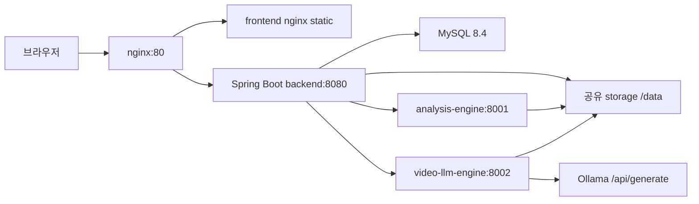

# 전체 서비스 구성

## 목적

이 문서는 현재 코드 기준의 서비스 구성을 설명한다. 구현 위치는 `frontend/`, `backend/`, `analysis-engine/`, `video-llm-engine/`, `infra/docker/docker-compose.yml`, `infra/nginx/nginx.conf`이다.

## 구성 요소

| 구성 요소 | 기술 | 역할 |
|---|---|---|
| frontend | React 18, Vite, Axios, React Router | 업로드, 분석 상태, 결과, 운영 콘솔 화면 |
| backend | Spring Boot 3.3.5, Java 21, Spring Security, JPA | 인증, 영상 저장, 분석 작업 상태, 엔진 호출, 결과 저장 |
| analysis-engine | FastAPI, faster-whisper, OpenCV, MediaPipe | STT, 음성/자세/시선/표정 지표, 점수 계산 |
| video-llm-engine | FastAPI, ffmpeg, Ollama 호출 | 샘플 프레임 추출, Qwen-VL 기반 시각 관찰 피드백 |
| mysql | MySQL 8.4 | 사용자, 영상, 분석 작업, 최종 결과 저장 |
| nginx | nginx 1.27 | `/api`는 backend, 그 외는 frontend로 프록시 |
| storage | `/data` 볼륨 | 업로드 영상, 변환 영상, 분석 산출물 저장 |

## 전체 구조

## 프론트엔드 페이지와 라우터

라우터는 `frontend/src/routes/AppRoutes.jsx`에 있다.

| path | 페이지 | 접근 |
|---|---|---|
| `/` | `HomePage` | 공개 |
| `/login` | `LoginPage` | 공개 |
| `/signup` | `SignupPage` | 공개 |
| `/upload` | `UploadPage` | 로그인 필요 |
| `/analyses/:jobId/status` | `AnalysisStatusPage` | 로그인 필요. 현재 `/upload?jobId=...`로 redirect |
| `/results` | `ResultListPage` | 로그인 필요 |
| `/results/:resultId` | `ResultDetailPage` | 로그인 필요 |
| `/admin` | `AdminPage` | `ADMIN` 또는 `MANAGER` |
| `/admin/system-logs` | `AdminPage` 내부 mock 로그 화면 | `AdminRoute` + 화면 내부에서 `ADMIN`만 허용 |
| `/admin/system-logs/:logId` | `AdminPage` 내부 mock 로그 상세 | `AdminRoute` + 화면 내부에서 `ADMIN`만 허용 |

## API 호출 구조

`frontend/src/api/httpClient.js`가 Axios 인스턴스를 만들고 `localStorage.accessToken`을 `Authorization` 헤더로 넣는다. 개발 서버에서는 `frontend/vite.config.js`가 `/api`를 `http://localhost:8080`으로 프록시한다.

## 미구현/주의

- 프론트엔드 `MetricScoreList`, `RadarScoreChart`, `VideoPlayer` 컴포넌트는 placeholder이다.
- 운영 콘솔의 시스템 로그는 `AdminPage.jsx`의 `SYSTEM_LOGS` 상수 기반 mock 데이터이다.
- 백엔드의 `OpenAiClient`, `OpenAiPromptBuilder`, `OpenAiResponseParser`, `FeedbackGenerateService` 등은 빈 클래스 또는 미구현 상태이다.
