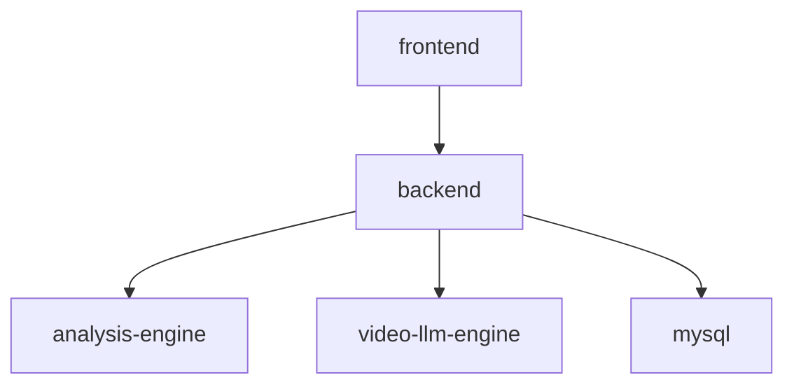

# 서버 분리 이유

## 현재 분리 구조

현재 프로젝트는 화면, API, 정량 분석, 영상 LLM 분석을 별도 프로세스로 분리한다.

## 분리 이유

### frontend

React/Vite 화면은 정적 파일로 빌드되고 nginx에서 제공된다. 백엔드와 분리되어 있어 UI 배포와 API 서버 배포를 독립적으로 다룰 수 있다.

### backend

Spring Boot는 인증, 소유권 검증, 트랜잭션, JPA 저장, 상태 관리에 집중한다. 분석 엔진의 Python 의존성과 분리되어 Java 서버가 무거운 ML 라이브러리를 직접 포함하지 않는다.

### analysis-engine

STT, OpenCV, MediaPipe, ffmpeg/ffprobe 사용은 Python 생태계가 자연스럽다. 현재 실제 점수 계산은 이 서버에서 수행한다.

### video-llm-engine

샘플 프레임 추출과 Ollama/Qwen-VL 호출은 별도 timeout, 모델 설정, fallback 정책이 필요하므로 정량 분석 엔진과 분리되어 있다.

## 운영상 장점

- 분석 엔진 장애가 백엔드 프로세스 자체를 바로 종료시키지 않는다.
- STT/비전 의존성 업데이트를 백엔드 빌드와 분리할 수 있다.
- 비디오 LLM provider를 `VIDEO_LLM_PROVIDER`로 교체하거나 mock으로 둘 수 있다.

## 현재 한계

- 백엔드는 두 엔진을 순차 호출한다. 병렬 실행은 미구현이다.
- 엔진 간 메시지 큐는 없다. 백엔드 `@Async` 스레드에서 HTTP 호출을 직접 수행한다.
- analysis-engine healthcheck는 docker-compose에 있으나 video-llm-engine healthcheck는 compose에 정의되어 있지 않다.
