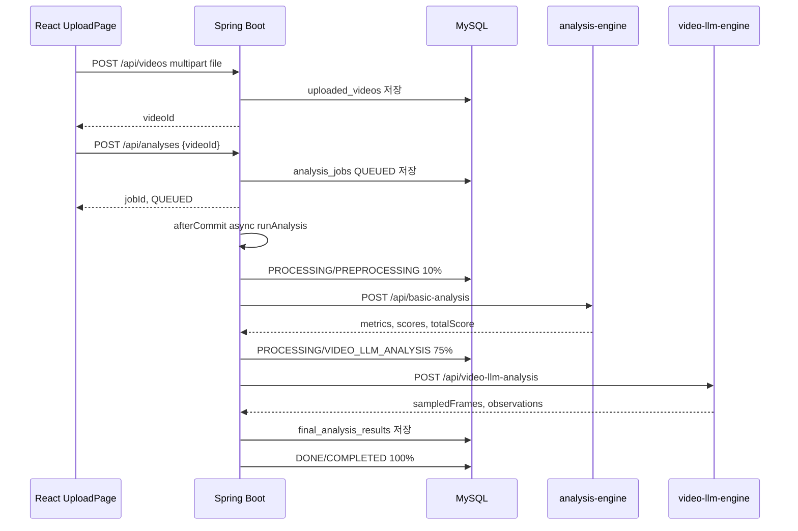

# 분석 파이프라인

## 시작 흐름

1. 사용자가 `/upload`에서 영상을 선택한다.
2. 프론트엔드가 `POST /api/videos`로 파일을 업로드한다.
3. 프론트엔드가 응답의 `videoId`로 `POST /api/analyses`를 호출한다.
4. 백엔드가 `AnalysisJob`을 `QUEUED` 상태로 저장한다.
5. 트랜잭션 commit 이후 `AnalysisPipelineService.runAnalysis(jobId)`가 `@Async("analysisTaskExecutor")`로 실행된다.

## 상태 단계

`AnalysisStep` enum 값은 다음과 같다.

`QUEUED`, `PREPROCESSING`, `AUDIO_ANALYSIS`, `VIDEO_ANALYSIS`, `STT_ANALYSIS`, `VIDEO_LLM_ANALYSIS`, `FEEDBACK_GENERATION`, `RESULT_MERGING`, `SAVING_RESULT`, `COMPLETED`, `FAILED`

현재 실제 pipeline에서 사용하는 단계는 `PREPROCESSING`, `AUDIO_ANALYSIS`, `VIDEO_LLM_ANALYSIS`, `RESULT_MERGING`, `COMPLETED`, `FAILED`이다. `VIDEO_ANALYSIS`, `STT_ANALYSIS`, `FEEDBACK_GENERATION`, `SAVING_RESULT`는 enum에는 있으나 현재 `runAnalysis()`에서 별도 update로 사용하지 않는다.

## 결과 병합

`AnalysisPipelineService.saveEngineResult()`는 다음을 저장한다.

- `scores_json`: analysis-engine의 `scores`
- `feedback_json`: analysis-engine `observations` + video-llm-engine `observations`
- `summary_json`: analysis-engine `summary`에 transcript, stt, metrics, videoInfo, videoLlm metadata, sampledFrames, extractedAudio 병합
- `total_score`: analysis-engine의 `totalScore`

## 프론트엔드 polling

`UploadPage.jsx`와 `ResultListPage.jsx`는 `QUEUED`, `PROCESSING` 상태일 때 4초 간격으로 상태/리포트를 다시 조회한다. `useAnalysisStatus.js`는 2초 polling 훅이지만 현재 status 페이지는 `/upload`로 redirect하는 구조이다.
