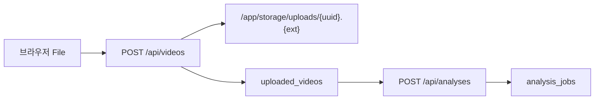
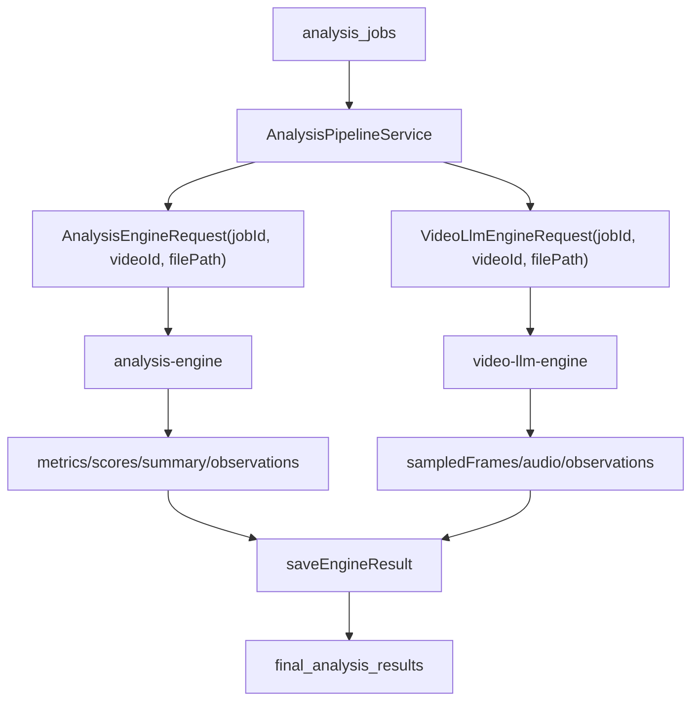

# 데이터 흐름

## 업로드 데이터 흐름

업로드 파일은 `VideoFileCommandService.upload()`에서 MIME 타입과 크기를 검증한 뒤 `STORAGE_ROOT/uploads` 아래 저장된다. DB에는 원본 파일명, 저장 파일명, 상대 경로, MIME 타입, 파일 크기가 저장된다.

## 분석 데이터 흐름

## 결과 조회 흐름

`ResultQueryService`는 `FinalAnalysisResult`의 세 JSON 컬럼을 `ObjectMapper`로 파싱해 `ResultDetailResponse`로 반환한다.

| DB 컬럼 | API 응답 필드 |
|---|---|
| `scores_json` | `scores` |
| `feedback_json` | `feedback` |
| `summary_json` | `summary` |
| `total_score` | `totalScore` |

## 삭제 흐름

리포트 삭제는 `AnalysisCommandService.deleteReport()`가 담당한다.

1. job 소유자 또는 `ADMIN`인지 확인한다.
2. `DONE`, `FAILED`, `CANCELED` 상태인지 확인한다.
3. `final_analysis_results`를 먼저 삭제한다.
4. `analysis_jobs`를 삭제한다.
5. 같은 video를 참조하는 job이 없으면 `uploaded_videos`와 영상 파일도 삭제한다.
6. commit 이후 job 임시 디렉터리, 변환 영상, 썸네일, 엔진 산출물 등을 파일 시스템에서 정리한다.

파일이 이미 없거나 개별 artifact 삭제가 실패하면 warning 로그를 남기고 DB 삭제는 계속한다. 다른 job이 같은 `uploaded_videos` row를 참조하면 원본과 video row는 보존한다.

## 미구현/주의

- `durationSeconds`는 `uploaded_videos` 엔티티에 있지만 업로드 시 채우지 않는다.
- 별도 `basic_analysis_results`, `video_llm_analysis_results`, `open_ai_feedback_results` 테이블은 현재 엔티티/JPA 저장 구현이 없다.
