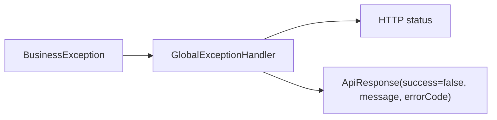
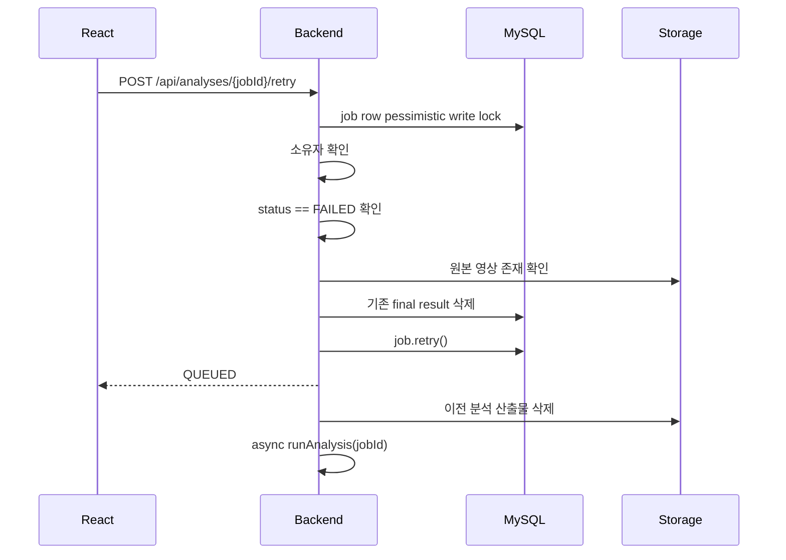

# 실패 처리 및 재시도 흐름

## 백엔드 오류 응답

`GlobalExceptionHandler`가 `BusinessException`과 validation 오류를 `ApiResponse.fail()`로 변환한다.

## 분석 실패 처리

`AnalysisPipelineService.runAnalysis()` 전체는 try/catch로 감싸져 있다. 분석 중 예외가 발생하면 `AnalysisFailureMessages.safeMessageFrom(exception)`으로 사용자 노출용 메시지를 만든 뒤 `AnalysisJob.fail(message)`를 호출한다.

실패 시 DB 변경:

- `analysis_jobs.status = FAILED`
- `analysis_jobs.step = FAILED`
- `analysis_jobs.message = "분석에 실패했습니다."`
- `analysis_jobs.error_message = 안전한 메시지`
- `analysis_jobs.completed_at = 현재 시각`

## 안전한 실패 메시지

`AnalysisFailureMessages`는 stack trace, SQL, 내부 경로, URL이 사용자에게 노출되지 않도록 알려진 코드와 안전 문구로 변환한다.

알려진 코드:

- `UNKNOWN_ERROR`
- `VIDEO_FILE_NOT_FOUND`
- `UNSUPPORTED_VIDEO_FORMAT`
- `ANALYSIS_ENGINE_ERROR`
- `RESULT_SAVE_ERROR`

## 재시도 흐름

## 재시도 가능 조건

- 요청자는 job 소유자여야 한다.
- 현재 상태가 `FAILED`여야 한다.
- `QUEUED` 또는 `PROCESSING`이면 `ANALYSIS_ALREADY_RUNNING`
- `FAILED`가 아니면 `ANALYSIS_RETRY_NOT_ALLOWED`
- 원본 영상 파일이 없으면 `ANALYSIS_SOURCE_VIDEO_MISSING`

## 현재 한계

- 최대 재시도 횟수 제한은 없다. `retryCount`만 증가한다.
- 엔진 호출 timeout은 WebClient `.block(Duration.ofMinutes(10))`에 고정되어 있다.
- 실패한 engine 세부 원인은 사용자에게 그대로 노출하지 않는다. 운영자용 상세 로그 저장 테이블은 미구현이다.
