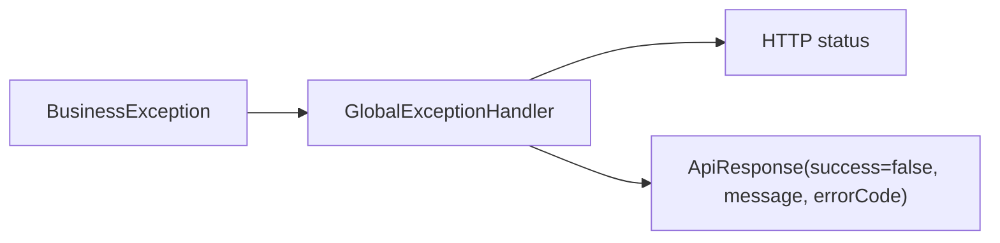
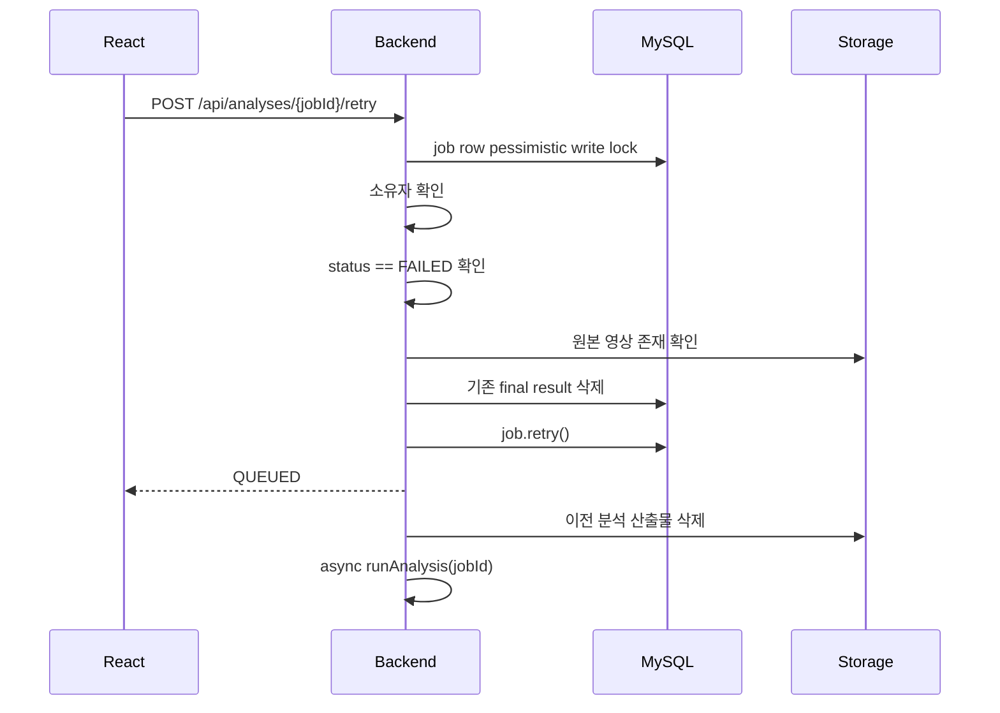

# 실패 처리 및 재시도 흐름

## 백엔드 오류 응답

`GlobalExceptionHandler`가 `BusinessException`과 validation 오류를 `ApiResponse.fail()`로 변환한다.

## 분석 실패 처리

`AnalysisPipelineService.runAnalysis()` 전체는 try/catch로 감싸져 있다. 분석 중 예외가 발생하면 `AnalysisFailureMessages.safeMessageFrom(exception)`으로 사용자 노출용 메시지를 만든 뒤 `AnalysisJob.fail(message)`를 호출한다.

실패 시 DB 변경:

- `analysis_jobs.status = FAILED`
- `analysis_jobs.step = FAILED`
- `analysis_jobs.message = "분석에 실패했습니다."`
- `analysis_jobs.error_message = 안전한 메시지`
- `analysis_jobs.completed_at = 현재 시각`

## 안전한 실패 메시지

`AnalysisFailureMessages`는 stack trace, SQL, 내부 경로, URL이 사용자에게 노출되지 않도록 알려진 코드와 안전 문구로 변환한다.

알려진 코드:

- `UNKNOWN_ERROR`
- `VIDEO_FILE_NOT_FOUND`
- `UNSUPPORTED_VIDEO_FORMAT`
- `ANALYSIS_ENGINE_ERROR`
- `RESULT_SAVE_ERROR`

## 재시도 흐름

## 재시도 가능 조건

- 요청자는 job 소유자여야 한다.
- 현재 상태가 `FAILED`여야 한다.
- `QUEUED` 또는 `PROCESSING`이면 `ANALYSIS_ALREADY_RUNNING`
- `FAILED`가 아니면 `ANALYSIS_RETRY_NOT_ALLOWED`
- 원본 영상 파일이 없으면 `ANALYSIS_SOURCE_VIDEO_MISSING`

## 현재 한계

- 사용자가 요청하는 수동 재시도 횟수 제한은 없다. `retryCount`만 증가한다.
- 엔진 호출 timeout은 WebClient `.block(Duration.ofMinutes(10))`에 고정되어 있다.
- 실패한 engine 세부 원인은 사용자에게 그대로 노출하지 않는다. 운영자용 상세 로그 저장 테이블은 미구현이다.

## Backend 재시작 복구

`ApplicationReadyEvent` 이후 `AnalysisRecoveryRunner`가 복구 대상만 조회한다.

| 시작 상태 | 복구 처리 |
|---|---|
| `QUEUED` | 원본 확인 후 DB에서 `PROCESSING`으로 원자적 claim하고 재실행 |
| `PROCESSING` | 불완전 결과와 job artifact를 정리하고 `QUEUED`로 되돌린 뒤 재실행 |
| `CANCEL_REQUESTED` | 결과와 artifact를 정리하고 `CANCELED`로 확정 |
| `DONE`, `FAILED`, `CANCELED` | 조회 및 변경하지 않음 |

pipeline의 일반 실행도 `status='QUEUED'` 조건부 UPDATE가 성공한 경우에만 외부 엔진을 호출한다.
따라서 startup event 중복이나 backend 다중 인스턴스에서도 같은 job을 한 번만 claim한다.

자동 복구는 기본 최대 3회다. 횟수를 초과하면 `FAILED`가 되고 사용자가 수동 재시도를 선택할 수 있다.
원본 영상이 없으면 내부 사유 `VIDEO_FILE_NOT_FOUND`와 안전한 사용자 메시지만 저장한다.

현재 analysis-engine과 video-llm-engine은 backend 요청과 독립된 job 조회 API를 제공하지 않는다.
따라서 backend가 종료된 직후 외부 엔진의 기존 HTTP 처리가 잠시 계속될 수 있으나, 그 응답은 사라진
backend에만 전달되며 최종 DB 결과는 새 backend의 원자적 claim 실행만 저장한다.
